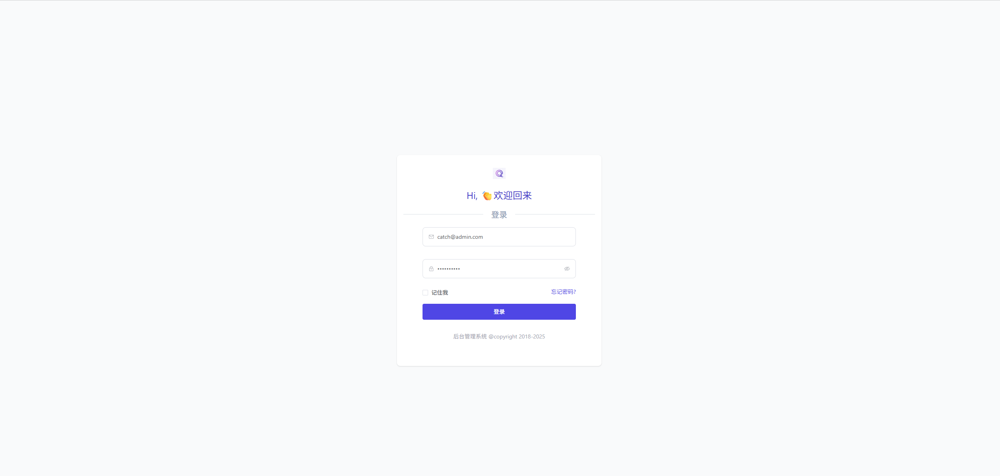
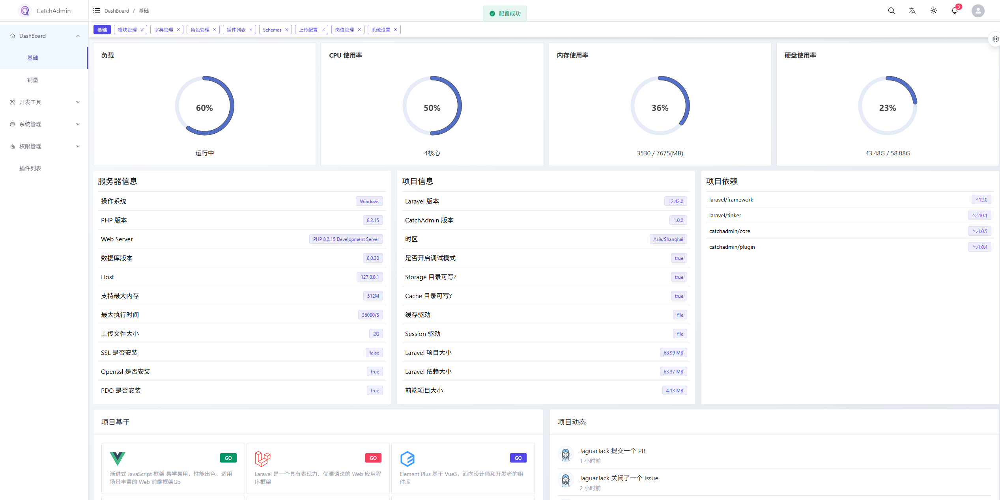
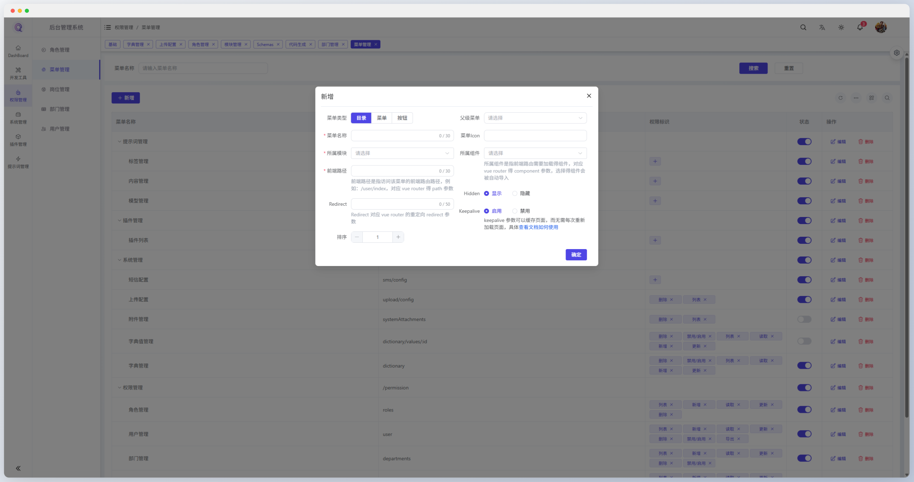
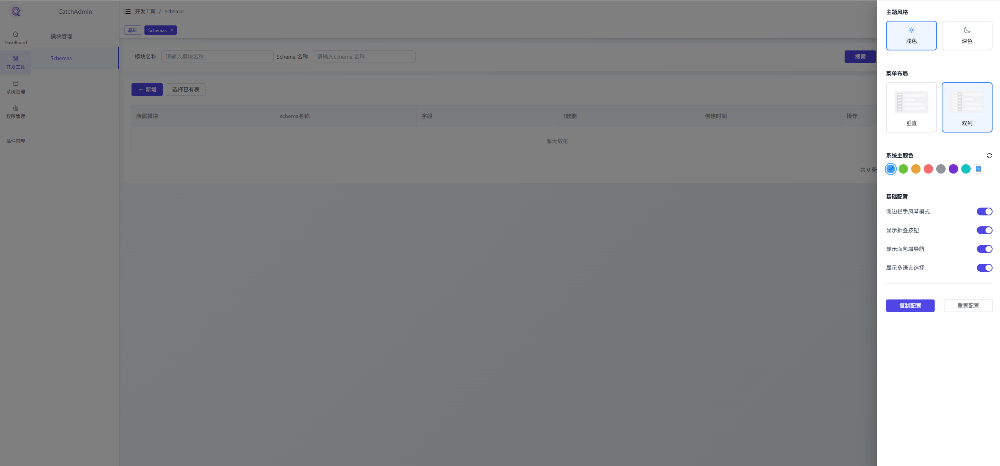
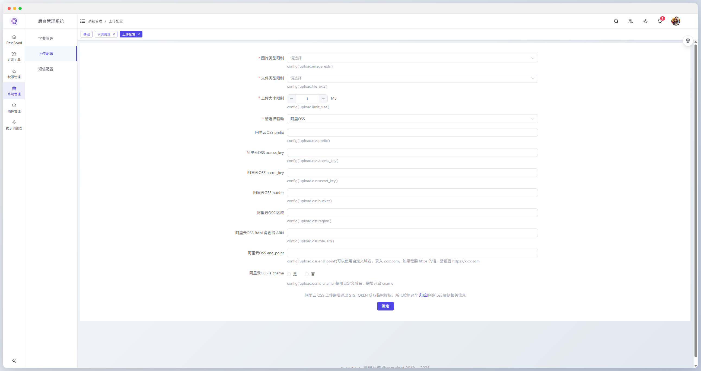
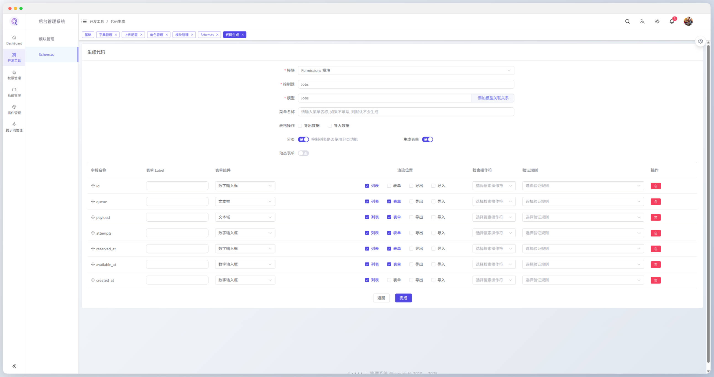
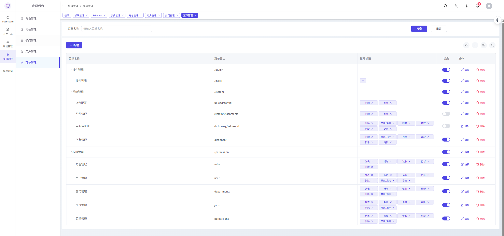
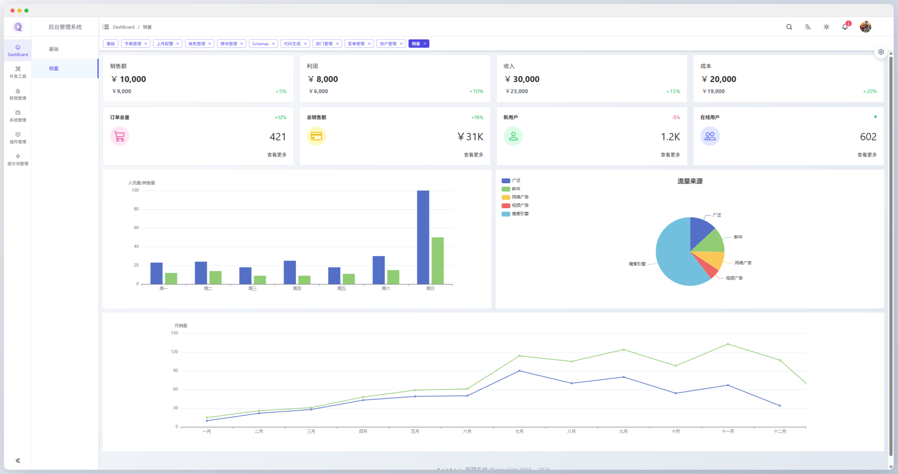

<br />
<div align="center">
    
    <h1 style="font-size:36px;font-weight:600;margin:0 0 6px 0;
  background:linear-gradient(
    120deg,
    #42a5f5 0%,
    #6a8dff 25%,
    #42a5f5 50%,
    #5c6bc0 75%,
    #42a5f5 100%
  );
  color:transparent;
  background-clip:text;
  -webkit-background-clip:text;
">CatchAdmin</h1>
    <p style="font-size: 17px;color: #6a8bad;margin-bottom: 10px;">五分钟快速搭建内置强大权限系统的功能完备的 PHP 后台管理系统</p>
    <a href="https://catchadmin.com" target="_blank">官网</a> |
    <a href="https://v5.catchadmin.com" target="_blank">演示</a> |
    <a href="https://catchadmin.vip/forum" target="_blank">社区</a> |
   <a href="https://catchadmin.vip/plugins" target="_blank">插件</a> |
    <a href="https://doc.catchadmin.com/" target="_blank">文档</a> |
    <a href="https://gitee.com/catchadmin/catchAdmin" target="_blank">Gitee仓库</a> |
    <a href="https://github.com/JaguarJack/catch-admin" target="_blank">GitHub仓库</a>
</div>
<br />
<p align="center">
    <a href="https://php.net/" target="_blank">
        
    </a>
    <a href="https://laravel.com/" target="_blank">
        
    </a>
    <a href="https://vuejs.org/" target="_blank">
        
    </a>
    <a href="https://element-plus.org/" target="_blank">
      
    </a>
    <a href="https://vitejs.dev/" target="_blank">
        
    </a>
    <a href="https://httpd.apache.org/" target="_blank">
      
    </a>
</p>

## 介绍

CatchAdmin 是基于 **Laravel 13 与 Vue 3** 的 PHP 开源后台管理系统，采用前后端分离与模块化架构。

项目提供用户与权限管理、系统配置、文件上传、附件管理、代码生成、导入导出和插件扩展等基础能力，可用于搭建 CMS、CRM、OA 等管理系统。

后台业务后端位于 `modules/`，前端页面位于 `web/src/views/`。每个模块独立组织控制器、模型、路由与数据库迁移，通用框架能力由 `catchadmin/core` 提供。

[中文](./README.md) | [英文](./README-en.md)

## 技术栈

| 分类 | 技术 |
| --- | --- |
| 后端 | PHP 8.3+、Laravel 13、Laravel Sanctum |
| 前端 | Vue 3.5、TypeScript 6、Vue Router 5、Pinia 3 |
| UI | Element Plus 2.13、TailwindCSS 4 |
| 构建 | Vite 8、Yarn |
| AI 接入 | Laravel MCP、Laravel Boost、CatchAdmin Skills |

前端由独立仓库维护，具体依赖版本以其 `package.json` 和 `yarn.lock` 为准。

## 核心功能

- **用户管理**：用户维护、启停、密码重置、个人中心、导入导出。
- **权限管理**：角色、部门、岗位、菜单与按钮权限，支持动态菜单和路由。
- **系统管理**：字典、系统配置、登录日志、操作日志、短信配置与模板。
- **文件管理**：本地上传、分片上传、云存储直传、附件及分类管理。
- **开发工具**：模块管理、表结构管理、数据库迁移和前后端 CRUD 代码生成。
- **插件扩展**：基于 Composer 管理插件，支持远程 Vue 组件运行时加载。
- **MCP 接入**：独立令牌管理、后台用户身份关联和工具调用记录。

项目提供数据范围与列权限扩展能力，业务模型可按需接入。

## 项目结构

```text
├─ app/                      # Laravel 应用代码
├─ bootstrap/                # 应用启动配置
├─ config/                   # 项目配置
├─ database/                 # 根级迁移、工厂与种子
├─ modules/                  # 后台业务模块
│  ├─ Common/                # 上传、地区、多语言和公共接口
│  ├─ Develop/               # 模块、表结构和代码生成
│  ├─ Permissions/           # 角色、部门、岗位和权限
│  ├─ System/                # 字典、配置、附件、短信和 MCP
│  └─ User/                  # 用户、登录、个人中心和日志
├─ public/admin/             # 后台前端构建产物
├─ routes/                   # 应用路由与 MCP 入口
├─ tests/                    # 自动化测试
└─ web/                      # 独立前端仓库
   └─ src/
      ├─ views/              # 业务页面
      ├─ components/         # 通用组件与 catch-table
      ├─ composables/curd/   # CRUD 数据操作
      ├─ support/            # HTTP、缓存和辅助函数
      ├─ router/             # 路由与登录守卫
      └─ stores/             # 状态管理
```

## 快速开始

### 环境准备

- PHP 8.3+ 及所需扩展
- Composer、Git
- Node.js 22.12+、Yarn
- MySQL 或 PostgreSQL

### 安装

```shell
composer create-project catchadmin/catchadmin catchadmin
cd catchadmin
php artisan catch:install
```

按提示填写应用地址和数据库配置。首次安装会创建环境配置、执行数据库迁移和基础数据初始化、创建存储链接，并下载前端项目、安装依赖和初始化插件管理。

当前安装器在 `.env` 已存在时直接展示安装信息；已有项目应根据实际状态补全配置和迁移。

### 本地开发

完成安装后，在项目根目录运行：

```shell
composer run dev
```

该命令同时启动前后端开发服务，默认地址为：

| 服务 | 地址 |
| --- | --- |
| Laravel | `http://127.0.0.1:8000` |
| Vite | `http://127.0.0.1:10086` |

前端也可单独启动：

```shell
cd web
yarn dev
```

### API 地址配置

后台 API 前缀由 `config/catch.php` 的 `route.prefix` 配置，核心包发布的默认值为 `api`。前端 `web/.env` 中的地址需与之对应：

```dotenv
VITE_BASE_URL=http://127.0.0.1:8000/api/
```

使用 `admin-api` 前缀时，对应设置为：

```dotenv
VITE_BASE_URL=http://127.0.0.1:8000/admin-api/
```

运行时配置 `static/config.js` 中的 `admin_config.BASE_URL` 设置有效值后，优先于环境变量。前端请求封装自动携带 `Request-from: Dashboard`，登录后附加 Bearer Token。

### 前端构建

```shell
cd web
yarn build
```

构建会先执行 TypeScript 检查，再输出到项目根目录的 `public/admin/`。

部署时为 `public/admin/` 配置前端静态站点，将 API 请求转发到 Laravel 的 `public/` 入口，并同步设置前端 API 地址。

## 前端项目

前端仓库：[catchadmin-vue](https://gitee.com/catchadmin/catch-admin-vue)，使用 `v5` 分支。

安装器将前端下载到项目根目录 `web/`。该目录在后端仓库的 `.gitignore` 中，前端改动在独立仓库中管理。

## 使用 AI 开发

- **[AGENTS.md](./AGENTS.md)**：为编码助手提供目录说明、开发约定和工作流程。
- **CatchAdmin Skills**：覆盖安装、模块开发、CRUD 生成、导入导出和上传等工作流。
- **Context7**：查询 CatchAdmin 等框架文档。
- **Laravel Boost**：获取 Laravel 文档及项目上下文。

发布 CatchAdmin Skills：

```shell
php artisan catch:publish:skills
```

> **AI 开发配套**：使用 AI 编程工具开发 CatchAdmin 时，可通过 [Right Code](https://rightapi.io/register?aff=f69ba2ee) 获取 AI API 服务。通过此邀请链接注册，充值可额外获得 5% 按量额度。

### 业务 MCP

项目通过 [routes/ai.php](./routes/ai.php) 注册 `/ai/mcp`，当前提供两个只读工具：

| 工具 | 功能 |
| --- | --- |
| `current-user` | 查询令牌关联的后台用户 |
| `dictionary-list` | 按关联用户权限查询字典 |

在后台 MCP Token 管理页面创建独立令牌，配置 MCP 客户端的服务地址，并携带请求头：

```http
Authorization: Bearer <token>
```

令牌支持过期、轮换、撤销和调用记录。字典查询工具的可用性由关联用户的权限决定。

## 体验地址
[demo 地址](https://v5.catchadmin.com)

[超管账户]
- 账户: `catch@admin.com`
- 密码: `catchadmin`

[测试账户]
- 账户: `test@admin.com`
- 密码: `Testadmin1`

## 讨论
- 可以提 `ISSUE`，请按照 `issue` 模板提问
- 添加微信好友，加微信入群，备注 `catchadmin`


## 版权信息
`CatchAdmin` 遵循 Apache2.0 开源协议发布，提供无需授权的免费使用。商业使用需要保留版权信息即可

## 项目预览
|                                                |                                                     |
|------------------------------------------------|-----------------------------------------------------|
|       |       |
|  |          |
|      |  |
|        |         |


## 视频教程
- [catchadmin 安装](https://www.bilibili.com/video/BV1eY411v71J/)
- [catchadmin 开发之模块创建](https://www.bilibili.com/video/BV1jP41127aW/)
- [catchadmin 之快速开发](https://www.bilibili.com/video/BV1Qh4y1J7eB/)

## 配套相关资源
- [Laravel 中文文档](https://laravel-docs.catchadmin.com/)
- [Laravel 免费入门教程](https://laravel-study.catchadmin.com)
- [Laravel Livewire 中文文档](https://laravel-livewire.catchadmin.com/)

## 开发检查

格式化 PHP：

```shell
composer format
```

执行静态分析：

```shell
composer analyse
```

运行后端测试：

```shell
composer test
```

## 感谢🙏
> 排名不分先后

- [Laravel](https://laravel.com)
- [Vue](https://cn.vuejs.org/)
- [ElementPlus](https://element-plus.org)
- [VitePress](https://vitepress.dev/zh/)

## 赞助商


面向企业应用与后台系统开发场景，[IPWO](https://www.ipwo.net/?ref=JaguarJack) 提供全球住宅代理服务。

支持开发者进行多地区网络环境测试、海外服务访问与业务场景验证，为全球化应用探索提供更多选择。提供免费测试，9折优惠码“0108”
